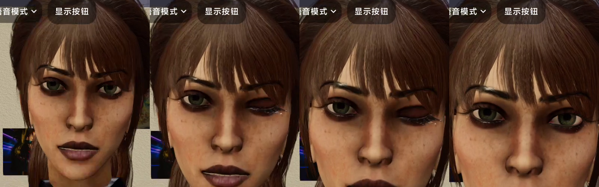

# P1 真机验收记录

日期：2026-10-18，Asia/Shanghai。基线 `9f20483` + 工作区 P0/P1 改动。

## 结论

**部分通过，尚不满足整体交互验收。** 本次样本中没有非法控制执行或控制串进入语音队列；能力目录缩小、动态候选、重复动作和模型切换已验证。但模型仍会漏发动作标签、只发标签不说话，语音服务也有超时。因此不能用“非法标签为零”代替“用户要求的动作已完成”。

验收中修复并复测了以下 P1 问题：

1. “街舞”未命中原来的“跳舞/舞蹈”关键词；增加明确的中文舞种和姿态元数据。
2. “请表演闪身步”未按中文资产显示名召回；恢复完整名称在自然句中的精确匹配，同时保留英文 tag 边界，避免 `dance_5` 误匹配 `dance_50`。
3. 标准情绪与眨眼序列混用时，只保留最后一个复位 cue；改为保留显式同名序列及最后一个独立情绪，并上报延迟步骤事件。
4. 提取器将原生表情名转小写后，正确生成的 `blinkLeft` 被误算为别名修复；现在根据原文名字判断是否发生兼容转换。

## 环境与隔离

| 项目 | 实际值 |
| --- | --- |
| 设备 | Redmi K20 Pro，adb 在线 |
| 应用 | `com.neethu.aiavatar_sdk`，1.2 / versionCode 3，Debug |
| LLM | 百炼 `qwen3.8-flash`，thinking=off |
| TTS | 百炼 `qwen3-tts-flash`，Cherry |
| 模型 / 场景 | `FreeTestCharacterAsuna_1024.vrm` / `home.glb` |
| 人物卡 | 未激活，persona=0ch |
| 修复后固定测试 | 100 条连续请求，同一上下文；每条等待 `TurnCompleted` |
| 历史 | 第 1 条 history=1，第 100 条 history=199；Demo 默认没有启用历史裁剪 |
| 常用动作 / 额外候选 | 24 个语义动作，额外候选最多 12 个 |
| 最终测试工具数 | 12；临时关闭长期记忆和自动提炼，移除了 3 个记忆工具；其他配置未改 |
| APK SHA-256 | `c0ac3fdffa622169715f83294cdc2714b028b4280f7e8457dae4a02200a174cd` |

已核对设备 `base.apk` 与本地构建 APK 的 SHA-256 相同。API Key、厂商、模型 ID、音色均未改动。固定输入大多附加“只说两个到八个字，不调用任何工具，不拍照”；这属于本测试集的约束，结果不能外推为所有自然对话的准确率。没有做同条件 P0 / P1 多次独立 A/B。

预检另有 12 条真实请求，当时记忆与 15 个工具均保持原设置。预检观察到工具续答重复台词、街舞/闪身步召回缺失、混合表情序列丢失，随后修复并重新安装。预检与后续模型切换探测不混入下表的 100 条统计。

## 100 条固定请求结果

| 指标 | 结果 |
| --- | --- |
| 回合收尾 | 100 / 100 出现 `TurnCompleted`，不代表全部语音成功 |
| 原始控制标签 | 112 个；本样本未出现词表外值或非法参数 |
| 非法控制执行 | 0 个观察到的事件 |
| 控制串进入 `SentenceQueued` | 0 个 |
| 别名修复 | 0 次；有限别名另由 Android 测试覆盖 |
| 动作 / 眨眼事件满足 | **48 / 72（66.7%）** |
| 前 68 条中的明确动作 / 眨眼要求 | **16 / 40（40%）** |
| 后 32 条连续动作要求 | **32 / 32（100%）** |
| 没有台词入队的回合 | **43 / 100** |
| TTS 片段失败 | **3 / 60** 个入队片段，均为 timeout：F001、F017、F049 |
| 工具调用回合 | 1 条：F090 调用 `get_device_time` 后重复点头，被 `BUSY` 拦截 1 次 |
| 首 token 延迟 | p50 **1427 ms**，p95 **2488 ms** |
| 首段播放开始延迟 | p50 **1387 ms**，p95 **2216 ms**；仅统计有播放开始事件的回合，43 个无台词回合不在分位数中 |

“事件满足”按测试表预先登记的动作 tag / 类别，或眨眼开始与复位事件判断，**不是 72 条全部经过视觉评分**。实际有 47 个回合出现 `ActionStarted`。原始标签合规通过当前 24 个常用映射、当轮额外候选和各命名空间目录检查，并结合客户端拒绝事件复核。系统 logcat 的长中文片段可能被 Android 截断，不能把日志里看不到完整目录误判为请求没有目录。

协议在同为 15 个工具的预检中为 4,118 字符、24 个动作；原排查记录是 13,113 字符、327 个动作。这里比较的是协议字符数，**不等同于 token 或费用下降比例**。

### 主要成功案例

| 样本 | 输入 / 关键输出 | 验证 |
| --- | --- | --- |
| F001 | 街舞 → `hip_hop_dancing_side_to_side` | 动态召回与执行；录像显示身体舞蹈；其中一个语音片段超时，不能算完整交互成功 |
| F002 | 闪身步 → `dodge_step` | 中文名称在自然句中召回；录像显示侧向闪步 |
| F003 | 开心、眨左眼 → `blinkLeft:1` / `blinkLeft:0` | 两个执行事件间隔约 205 ms；录像明确显示单眼闭合与恢复；原生大小写正确时不再误记别名 |
| F004–F006 | `wave` / `nod` / `bow` | 语义短名找到相应资产并产生执行事件；未对动作幅度逐项主观打分 |
| F031 | 第 31 轮才要求伦巴 → `female_rumba_dancing_loop` | 后续轮可选此前未使用的动作，protocol 保持 full |
| F098–F099 | 萨尔萨 → “再做一次刚才的舞蹈” | 两轮均启动 `female_salsa_dancing`；成功动作保留为下轮候选 |

眨眼录像抽帧，按从左到右排列；图片仅用于动作复核：



### 未通过项目

- **漏发动作控制。** F007 的允许候选里有 `sitting_on_the_floor`，原始输出却只有“坐地板啦～”；F008 的候选包含钢琴动作，但只说“听好啦～”。多条常用身体动作也出现只说台词、不发 `<act:…>` 的情况。不是执行层拒绝了标签，而是模型没有生成标签。
- **只发控制、不说台词。** 长对话中多数挥手/点头能执行，但原始输出只有 `<emo:…><act:…>`。目前“空回复重试”检查原始缓冲是否为空，不能把这类输出识别为“没有可朗读台词”；本次未增加整轮重试，以免重复已执行动作。
- **语音超时。** 三个片段出现 `SentenceFailed timeout`，回合仍正常收尾；没有做实际听感评测，不能据 `TurnCompleted` 宣称全部语音播出。
- **工具续答重复。** 预检问候重复三遍，固定集 F090 重复点头。P1 身体动作互斥成功阻止抢占，但不会自动去重已经说过的普通台词。

下一轮应分别处理“明确动作意图但漏发控制”“已有控制但台词为空”“工具续答重复”与 TTS 超时，再用相同固定输入复测。约束枚举只能限制可生成值；如果仍允许省略动作或空台词，它不会自动解决这些质量问题。

## Android 运行时测试与模型切换

新增 [InlineTagDeviceAcceptanceTest](../app/src/androidTest/java/com/neethu/aiavatar_sdk/InlineTagDeviceAcceptanceTest.kt)，实际在该手机运行，**5 项通过、0 失败，耗时 19.299 秒**：

- 畸形、空参数、错误参数、未知命名空间和超长控制串在每个字符位置切分后都不成为正文。
- 有限舞台指示移除，普通括号台词保留。
- APK 内语义映射目标可打开、候选有界、真实资产超出允许范围时拒绝。
- 别名、关闭能力和未知名产生不同结果。
- 丢弃状态可恢复，reset 后下一轮不受旧状态影响。

这些测试直接调用 Android 上的解析器/注册表，不把它们冒充真实 LLM 或扬声器测试。固定集的模型输出没有畸形标签，因此畸形串的系统性覆盖来自这些确定性测试和 JVM 回归。

额外将 VRM 切到 `10.vrm`，原生表情目录由 **68 → 14**，协议更新为 **3,135 字符**。M01 实际输出 `blinkLeft:1`、`blinkLeft:0`、`happy:0.8`、`nod`，均产生相应执行事件，随后恢复原模型。模型恢复后还尝试了一条更宽松的坐姿探测 O01，但在采集器 65 秒窗口内没有收到首 token，随后手工打断；它不属于上述 100 条固定样本，本次未定位此网络/服务等待原因。没有覆盖真机开关镜头、资源加载失败和历史裁剪的全部组合；相应分支由已有单元测试覆盖，不能据此宣称所有设备组合已验收。

修复后的 JVM 回归：**970 项全部通过**（adapter 134、orchestrator 542、app 294），Debug APK 与 Android 测试 APK 构建成功，`git diff --check` 通过。

## 证据与复现

- [固定输入与预登记动作](validation/p1-device-20261018/cases.json)
- [逐条结果、原始回复与解析后正文](validation/p1-device-20261018/results.csv)
- [统计摘要](validation/p1-device-20261018/summary.json)
- [设备与 APK 信息](validation/p1-device-20261018/environment.json)
- [Android 测试原始结果](validation/p1-device-20261018/android-tests.txt)

Android 测试可复现：

```bash
./gradlew :app:connectedDebugAndroidTest \
  -Pandroid.testInstrumentationRunnerArguments.class=com.neethu.aiavatar_sdk.InlineTagDeviceAcceptanceTest
```

LLM 测试用 `ai_cmd new_context` 和 `send_chat`，逐条等待 `TurnCompleted`，抓取 `LlmPrompt`、`AvatarSession`、`AIDebug`、`GestureDriver`。原始日志、屏幕录像和采集脚本在 `/tmp/aiavatar-p1-acceptance-20261018/`；该临时目录可能被系统清理，以上汇总与固定输入已保存到仓库。


## 恢复与清理

结束时已切回原上下文 **`33ba4616`，仍为 18 条消息**；原模型、`home.glb` 场景与服务商/模型/音色均已恢复，phase=IDLE、error=none。镜头恢复默认自由视角；未声称逐浮点还原安装前相机姿态。长期记忆与自动提炼开关均恢复为原来的 `true`。

预检有一次模型通过记忆工具写入了测试生成的偏好，已按其唯一 ID 删除；复查没有保留本次验收新建的长期记忆，全局待提炼窗口为空，其他舞台角色的待提炼窗口保留。测试 APK 包 `com.neethu.aiavatar_sdk.test` 已卸载，修复后的 Debug 主应用保留在设备上。

测试上下文 `7f217138`（预检，24 条消息）、`7812a11d`（固定集，200 条消息）、`cdb25de7`（额外探测，3 条消息）保留，供回放审计。原上下文没有追加验收消息。
